

  

  <a href="https://www.linkedin.com/in/salomon-nieto/">LinkedIn ↗</a>
  &nbsp; / &nbsp;
  <a href="https://github.com/jsalonl?tab=repositories">Code ↗</a>
  &nbsp; / &nbsp;
  <a href="#the-crew">The crew ↓</a>

## Hey, I'm Joan.

Telecommunications engineer, full-stack developer, and **Go expert**, currently at **[Globant](https://www.globant.com/)**. I work from **Villavicencio, Colombia**, and have been doing the remote thing since **2010**.

Go is where I spend most of my time. I also work across the stack, use AI tools, and still prefer tabs over spaces.

## The workbench

### Backend

  <a href="https://go.dev/">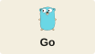</a>
  <a href="https://www.java.com/">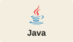</a>
  
  <a href="https://nodejs.org/">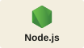</a>
  <a href="https://www.php.net/">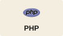</a>
  <a href="https://laravel.com/">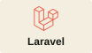</a>

### Frontend

  <a href="https://nextjs.org/">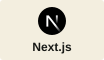</a>
  <a href="https://react.dev/">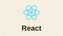</a>
  <a href="https://developer.mozilla.org/en-US/docs/Web/JavaScript">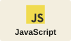</a>
  <a href="https://tailwindcss.com/">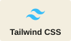</a>
  
  <a href="https://developer.mozilla.org/en-US/docs/Web/CSS">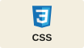</a>

### Infra & delivery

  <a href="https://www.docker.com/">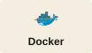</a>
  <a href="https://aws.amazon.com/">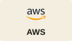</a>
  <a href="https://git-scm.com/">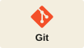</a>
  <a href="https://www.kernel.org/">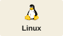</a>
  <a href="https://www.jenkins.io/">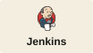</a>
  <a href="https://www.gnu.org/software/bash/">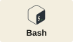</a>

### Data

  
  <a href="https://www.mysql.com/">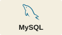</a>
  
  <a href="https://www.oracle.com/database/">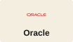</a>

## AI is on the workbench too

  <a href="https://claude.ai/">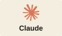</a>
  <a href="https://developers.openai.com/codex/">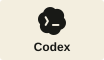</a>
  <a href="https://opencode.ai/">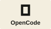</a>
  <a href="https://gemini.google.com/">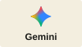</a>
  <a href="https://cursor.com/">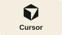</a>

Coding agents, terminal workflows, context, and prompts. I use AI to explore ideas, work through a problem, or get a refactor moving. Then I read the diff.

## A few things I've built

### [go-config](https://github.com/jsalonl/go-config)

Load JSON or YAML into Go structs, substitute environment variables, read `.env` files, and plug in custom unmarshalling.

### [go_multi_version_db](https://github.com/jsalonl/go_multi_version_db)

A Go REST API using Abstract Factory to select database engines and versions at runtime through environment variables.

### [api-crud-interceptor](https://github.com/jsalonl/api-crud-interceptor)

A Java REST API example with a DDD structure, unit tests, exception handling, Swagger docs, and request/response logging.

[The rest is over here →](https://github.com/jsalonl?tab=repositories)

---

## The crew

At home: **Vivi, my wife and best friend**, and five pets with *One Piece* names. The naming convention got out of hand.

  

**Zoro · Lucy · Franky · Nami · Robin.**

For the two who sailed ahead: always part of the crew. ♡

## Say hi

Go, AI tooling, side projects, or *One Piece* — **[find me on LinkedIn](https://www.linkedin.com/in/salomon-nieto/)**.

 

  

