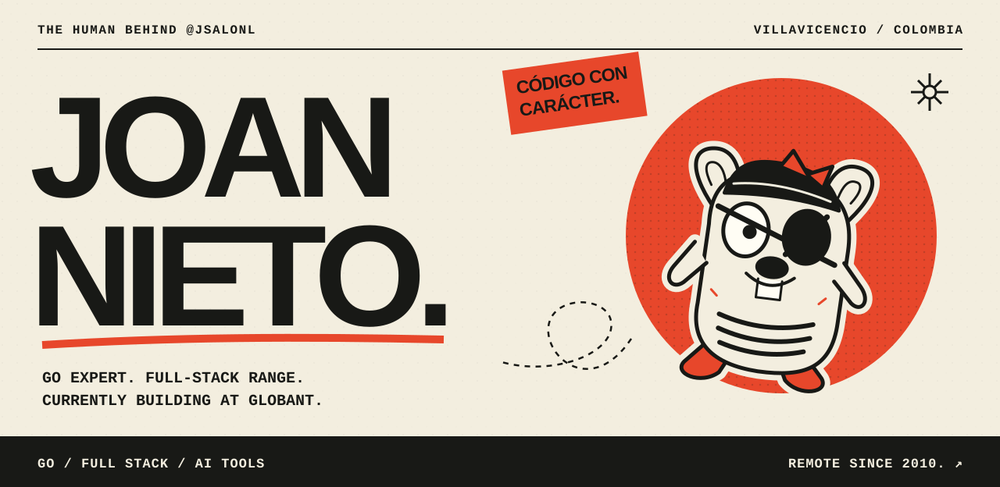
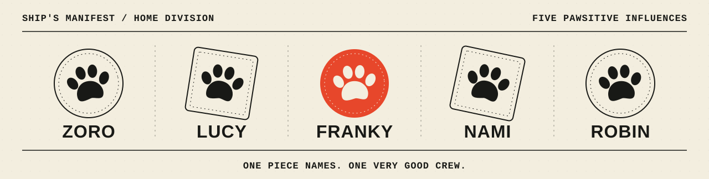
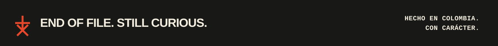

  

  <a href="https://www.linkedin.com/in/salomon-nieto/">LinkedIn ↗</a>
  &nbsp; / &nbsp;
  <a href="https://github.com/jsalonl?tab=repositories">The code ↗</a>
  &nbsp; / &nbsp;
  <a href="#the-crew">The crew ↓</a>

## Go is my home turf.

I'm **Joan Nieto** — telecommunications engineer, full-stack developer, and **Go expert**, currently at **[Globant](https://www.globant.com/)**. Based in **Villavicencio, Colombia**. Working remotely since **2010**.

I like software with a clear purpose, code you can actually read, and enough curiosity to question the usual way of doing things. Serious about the craft. A little irreverent about everything else.

**Código con carácter. Y sin tanta vuelta.**

---

## 01 / The toolbox

**Go takes the lead.** The rest of the stack earns its place.

| Territory | Tools I work with |
| :--- | :--- |
| **Backend** | **Go** · Java · Spring · Node.js · PHP · Laravel |
| **Frontend** | React · JavaScript · HTML · CSS · Tailwind CSS |
| **Delivery** | Docker · AWS · Jenkins · Linux · Bash · Git |
| **Data** | PostgreSQL · MySQL · MongoDB · Oracle |

Telecom roots. Full-stack range. Tabs over spaces. Some convictions survive every refactor.

## 02 / Show me the code

### [go-config ↗](https://github.com/jsalonl/go-config)

Configuration without the ceremony. A Go library for loading JSON and YAML into structs, with environment-variable substitution, `.env` support, and custom unmarshalling.

`Go` `Configuration` `Developer tooling`

### [go_multi_version_db ↗](https://github.com/jsalonl/go_multi_version_db)

One API, different database engines and versions. A Go REST API exploring Abstract Factory, with the database implementation selected at runtime through environment variables.

`Go` `REST API` `Design patterns`

### [api-crud-interceptor ↗](https://github.com/jsalonl/api-crud-interceptor)

A look at the Java side: a REST API example with a DDD structure, unit tests, custom exception handling, Swagger documentation, and request/response logging.

`Java` `Spring` `DDD`

[More experiments, tools, and telecom adventures →](https://github.com/jsalonl?tab=repositories)

---

## 03 / The crew

Off the clock: **Vivi, my wife and best friend**, and a home with its own little Grand Line. Yes, the names are from *One Piece*. Yes, this is a recurring theme.

  

**Zoro · Lucy · Franky · Nami · Robin.** Five pets. One very good crew.

For the two who sailed ahead: always part of the crew. ♡

## 04 / Open a channel

Want to talk **Go, backend engineering, or building something with a point of view**?

**[Find me on LinkedIn ↗](https://www.linkedin.com/in/salomon-nieto/)**

 

  

